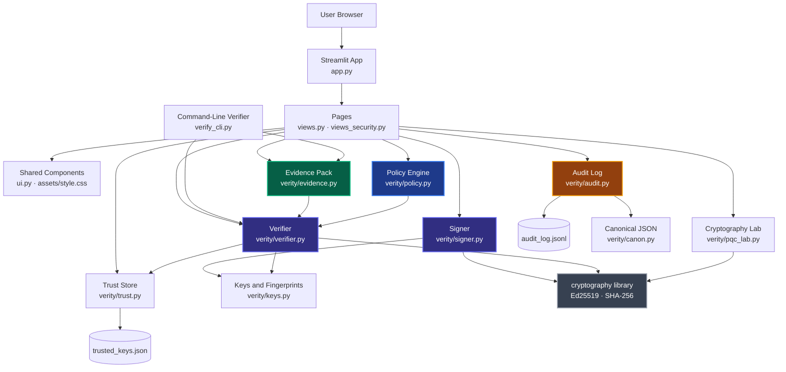
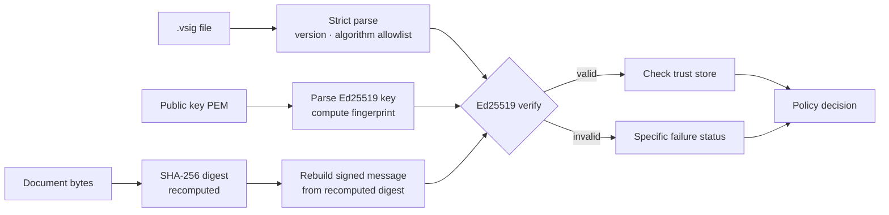

<div align="center">

# VeritySign

### Digital Signature Document Verifier · Tamper Detection · Independent Evidence · Audit Trail

Verify the bytes. Know the signer.

[](https://www.python.org/)
[](https://streamlit.io/)
[](https://cryptography.io/)
[](#testing)
[](#limitations)

[About](#about) | [Architecture](#architecture) | [Tech Stack](#tech-stack) | [Getting Started](#getting-started) | [Command-Line Verifier](#command-line-verifier) | [Pages](#pages) | [Testing](#testing)

</div>

---

## Table of Contents

- [About](#about)
- [Architecture](#architecture)
- [Signature Format](#signature-format)
- [Tech Stack](#tech-stack)
- [Getting Started](#getting-started)
- [Command-Line Verifier](#command-line-verifier)
- [Pages](#pages)
- [Testing](#testing)
- [Project Structure](#project-structure)
- [Limitations](#limitations)
- [Collaborators](#collaborators)

---

## About

VeritySign checks three separate questions about a signed document and never merges them into one vague "authentic" label:

1. **Integrity**: are these the exact bytes that were signed?
2. **Signature validity**: was the signature produced by the private key matching this public key?
3. **Signer trust**: is that key one you have chosen to trust locally?

### What it does

- Generates Ed25519 key pairs and signs any file, producing a detached `.vsig` signature file
- Verifies a document, signature file and public key. The SHA-256 digest is **recomputed from the uploaded file** and the claimed digest in the signature file is never trusted
- Reports "Signature valid" and "Signer trusted" as two independent verdicts, with a specific reason for every failure
- Exports a self-contained **evidence pack** that anyone can re-verify offline, with a command-line verifier that needs no UI
- Records signing and verification events in a **hash-linked audit log** that detects edited, reordered or removed records
- Applies a **verification policy** (Standard, Strict, Demonstration or custom) after the cryptographic check. A policy can never turn an invalid signature into a valid one
- Includes an experimental **Cryptography Lab** comparing Ed25519 with the NIST post-quantum signature standard ML-DSA

### What it does not claim

It does not prove who the signer really is, that the content is true, or when the document was signed. See [Limitations](#limitations).

---

## Architecture



### Verification Flow



### Core Components

| Component | Responsibility |
|-----------|----------------|
| `verity/verifier.py` | Parses the `.vsig` file, recomputes the digest, runs the real signature check, returns a structured `VerificationResult` |
| `verity/signer.py` | Builds the domain-separated signed message and creates `.vsig` files |
| `verity/keys.py` | Ed25519 key generation, PEM loading, SHA-256 key fingerprints |
| `verity/trust.py` | Local store of pinned key fingerprints (`trusted_keys.json`) |
| `verity/evidence.py` | Builds and independently verifies evidence packs |
| `verity/policy.py` | Strict policy schema, built-in policies, rule-by-rule evaluation |
| `verity/audit.py` | Hash-linked JSON Lines log and chain verification |
| `verity/pqc_lab.py` | Experimental Ed25519 vs ML-DSA measurements |
| `verify_cli.py` | Independent command-line verifier using the same library, with no UI |

---

## Signature Format

The `.vsig` file is versioned JSON. The bytes that are actually signed are not the JSON but a fixed message:

```text
"VeritySign-v1\0" + "Ed25519" + "\0" + SHA-256(document) + document_size (8 bytes, big-endian)
```

- The prefix provides domain separation, so the signature cannot be reused in another protocol
- The algorithm and the document size are bound into the message
- Metadata such as `signed_at` and `doc_name` is self-reported and unauthenticated

---

## Tech Stack

| Tech | Purpose |
|------|---------|
| Python 3.10+ | Language |
| Streamlit | Interface and page navigation |
| `cryptography` | Ed25519, SHA-256 digests, ML-DSA (lab only) |
| pytest | Automated tests |
| Material Symbols | Icon set (single library) |
| Inter | Interface font |

No database, accounts or cloud service. Files are processed in memory only.

---

## Getting Started

### Prerequisites

- Python 3.10 or newer
- pip

### Installation

Run these from inside the project folder so the theme in `.streamlit/config.toml` is applied.

```bash
pip install -r requirements.txt
streamlit run app.py
```

Open the address Streamlit prints (usually [http://localhost:8501](http://localhost:8501)).

### Demo files (optional)

```bash
python make_samples.py
```

Creates `samples/` with a document, a signature, a tampered copy and demo keys. The keys are for demonstration only and the folder is git-ignored.

---

## Command-Line Verifier

Re-verify without the web interface:

```bash
python verify_cli.py evidence my_document.vevidence.json --document my_document.pdf
python verify_cli.py detached document.txt document.txt.vsig public_key.pem
```

| Exit code | Meaning |
|-----------|---------|
| `0` | Verified |
| `1` | Not verified |
| `2` | Input file could not be read |
| `3` | Signature valid over the recorded digest, but no document was examined |

---

## Pages

| Path | Page |
|------|------|
| `/` | Dashboard: session counters computed from real verifications, outcomes chart, how it works |
| `/verify` | Verify a document, signature and public key, with policy evaluation and report download |
| `/evidence` | Evidence Center: create packs, verify packs, guided end-to-end demo |
| `/demo` | Demo and Tamper Lab: four live scenarios and a one-bit tamper demonstration |
| `/audit` | Audit Trail: view records, verify the chain, controlled tamper demonstration |
| `/policies` | Verification Policies: rule definitions, comparison, custom policy files |
| `/lab` | Cryptography Lab (experimental): Ed25519 vs ML-DSA |
| `/studio` | Signer Studio: generate keys and sign documents |
| `/trust` | Trust Store: pin and remove key fingerprints |
| `/history` | Session verification history with filter |

---

## Testing

```bash
python -m pytest
```

Last run: **69 passed**.

| Test file | Tests | Covers |
|-----------|-------|--------|
| `tests/test_verifier.py` | 18 | Valid, tampered, wrong key, corrupt or missing signature, malformed key, unsupported algorithm, empty and oversize input |
| `tests/test_evidence.py` | 20 | Valid and digest-only packs, modified document, signature or manifest, bad JSON, oversize, command-line exit codes |
| `tests/test_audit.py` | 11 | Valid and empty chain, modified, reordered and missing records, truncation with and without an anchor |
| `tests/test_policy.py` | 15 | Unknown and trusted keys, invalid signatures under every policy, policy-file tampering |
| `tests/test_pqc_lab.py` | 5 | ML-DSA sign, verify, tamper, wrong key, FIPS 204 sizes |

---

## Project Structure

```text
VeritySign/
├── app.py                     # Entry point and navigation
├── views.py                   # Dashboard, Verify, Studio, Demo, Trust Store, History
├── views_security.py          # Evidence Center, Audit Trail, Policies, Cryptography Lab
├── ui.py                      # Shared components (cards, badges, tables, verdicts)
├── verify_cli.py              # Independent command-line verifier
├── make_samples.py            # Generates demo files into samples/
├── requirements.txt
├── assets/
│   └── style.css              # Design tokens and styles
├── .streamlit/
│   └── config.toml            # Theme
├── verity/
│   ├── keys.py                # Key generation, PEM loading, fingerprints
│   ├── signer.py              # Signed-message construction and signing
│   ├── verifier.py            # Parsing, hashing, verification, results
│   ├── trust.py               # Local trust store
│   ├── evidence.py            # Evidence pack build and verify
│   ├── policy.py              # Policies and evaluation
│   ├── audit.py               # Hash-linked audit log
│   ├── canon.py               # Canonical JSON for hashing
│   ├── report.py              # JSON and HTML reports
│   ├── errors.py              # Status codes and explanations
│   └── pqc_lab.py             # Experimental Ed25519 vs ML-DSA lab
├── tests/                     # 69 pytest tests
└── docs/
    └── SECURITY_FEATURES.md   # Design, scoring, threat model, references
```

---

## Limitations

- A valid signature proves only that the key holder signed these bytes. It does not prove real-world identity, truthfulness or signing time
- The trust store is a local list of fingerprints. There is no certificate chain, PKI or revocation
- `signed_at` and audit timestamps come from the local clock and are not trusted time
- The audit log detects edits and middle deletions. Deleting the newest records or rebuilding the whole chain is only detected if you supply an external anchor
- It verifies VeritySign `.vsig` signatures over file bytes. It does not validate signatures embedded inside PDFs (PAdES)
- Only Ed25519 is accepted for signing. ML-DSA appears only in the experimental lab
- Verification history is kept in memory for the browser session only

Full design notes and threat model: [docs/SECURITY_FEATURES.md](docs/SECURITY_FEATURES.md).

---

## Collaborators

<table>
  <tr>
    <td align="center"><a href="https://github.com/aadarshpp"><b>Aadarsh P P</b></a><br/>@aadarshpp</td>
    <td align="center"><a href="https://github.com/Abhinerd"><b>Abhinav</b></a><br/>@Abhinerd</td>
    <td align="center"><a href="https://github.com/L11cif3r"><b>Sourav S</b></a><br/>@L11cif3r</td>
    <td align="center"><a href="https://github.com/Rudraagh"><b>Arun Sreekumar</b></a><br/>@Rudraagh</td>
    <td align="center"><a href="https://github.com/t0k1t00"><b>Swathi B Raj</b></a><br/>@t0k1t00</td>
  </tr>
</table>

---

<div align="center">
  VeritySign &nbsp;·&nbsp; <br/>
  Built with Python, Streamlit and the cryptography library
</div>
